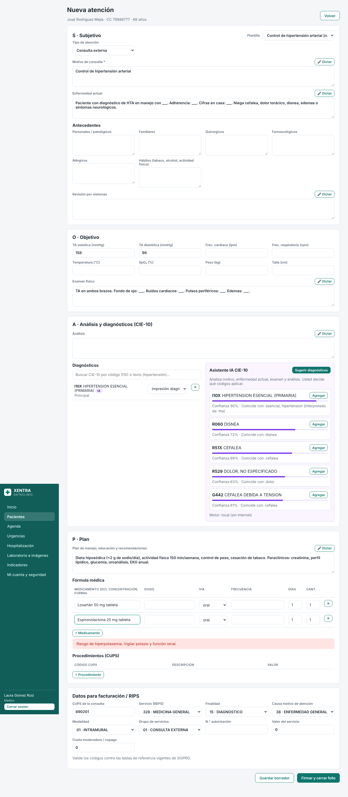
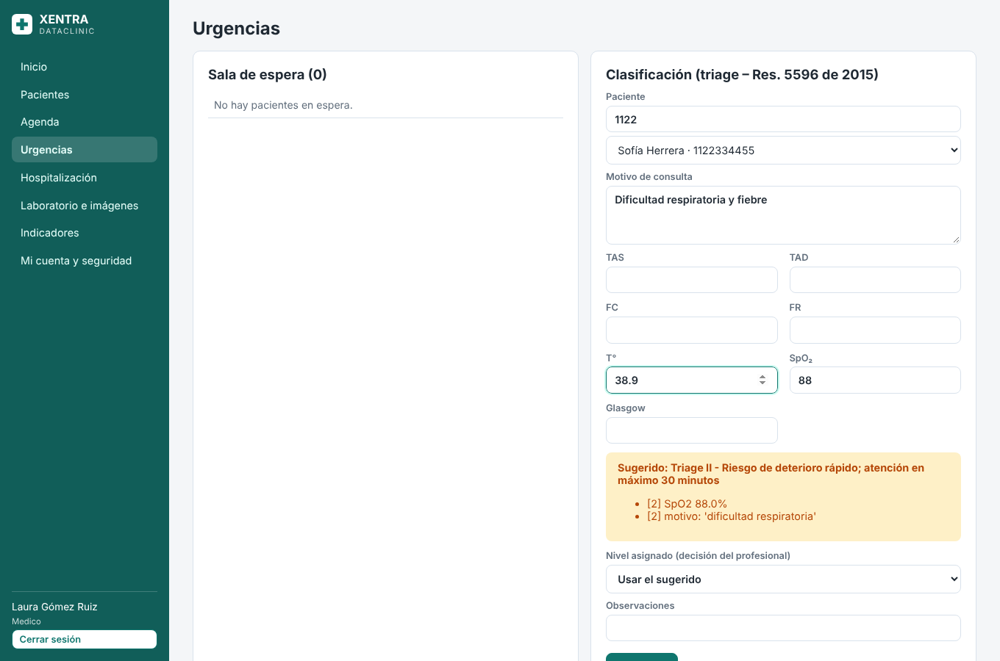
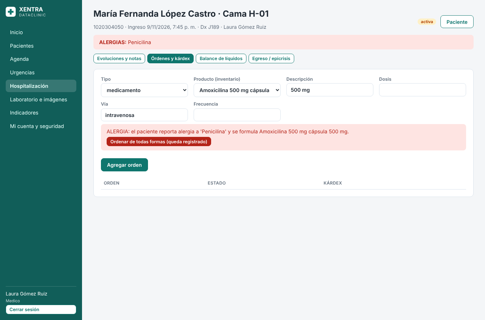
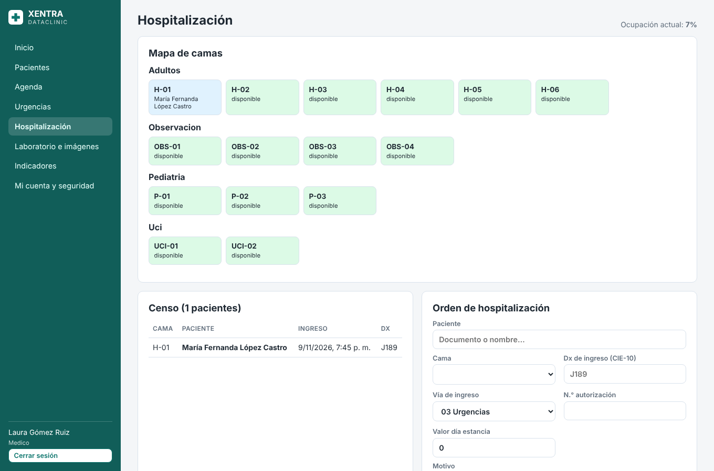
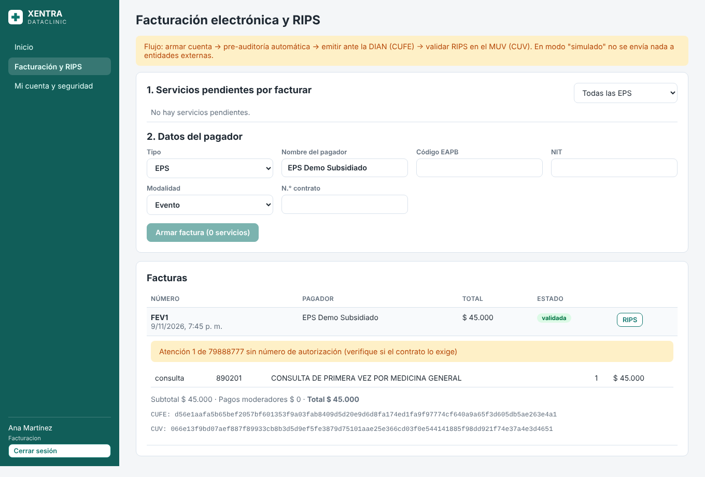
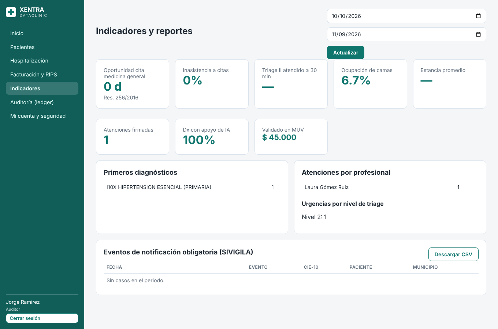

# XENTRA DATACLINIC

**Historia Clínica Electrónica (HCE) y gestión hospitalaria para Colombia.** Incluye libro de auditoría
inmutable tipo *blockchain*, RIPS en JSON (Resolución 2275 de 2023) con factura electrónica y validación en el MUV,
inteligencia artificial para CIE-10, interoperabilidad HL7 FHIR R4 y portal del paciente.

| Capa | Tecnología |
|---|---|
| Backend (API) | **Python 3.13 + FastAPI + SQLAlchemy 2 + Alembic** |
| Base de datos | **PostgreSQL 16** con triggers de inmutabilidad y usuario de aplicación sin privilegios |
| Frontend | **Vue 3 + TypeScript + Vite + Pinia** |
| IA | Motor local (sin internet) + **Claude** de Anthropic (opcional, con anonimización) |
| Interoperabilidad | **HL7 FHIR R4** (`/fhir`) |
| Despliegue | **Docker Compose + Nginx + Caddy (HTTPS automático)** + respaldos diarios |

> **Sobre "PostgREST"**: **PostgreSQL** es la base de datos; **PostgREST** es otra herramienta que expone la BD
> como API. Con FastAPI **no se necesita** (ver [docs/01-arquitectura.md](docs/01-arquitectura.md)).

---

## Módulos (versión 0.2)

| Módulo | Qué hace |
|---|---|
| **Pacientes** | Registro con campos RIPS, alergias destacadas, autorización Ley 1581, resumen clínico con IA |
| **Historia clínica** | Formato SOAP, plantillas por tipo de consulta, **dictado por voz**, signos vitales con alertas, fórmula médica con **alertas de alergia e interacciones en tiempo real**, firma que sella el folio, notas aclaratorias, **PDF con código QR** de verificación |
| **IA CIE-10** | Sugiere diagnósticos desde el texto clínico, entiende lenguaje coloquial, filtra por sexo/edad y nunca inventa códigos |
| **Agenda** | Citas por profesional, disponibilidad, cruces de horario, **telemedicina** (sala de video), recordatorios, reprogramación |
| **Urgencias** | **Triage** I–V (Res. 5596 de 2015) con sugerencia automática, sala de espera ordenada por prioridad y tiempos máximos |
| **Hospitalización** | Mapa de camas, ingreso, evoluciones médicas y notas de enfermería, órdenes médicas, **kárdex**, balance de líquidos, traslados, egreso con **epicrisis** sellada |
| **Laboratorio e imágenes** | Órdenes, toma de muestra, resultados con valores anormales resaltados, validación que sella el resultado |
| **Farmacia** | Inventario por lotes y vencimientos, entradas, ajustes, alertas, **dispensación FEFO** de fórmulas y órdenes |
| **Consentimientos** | Plantillas, **firma manuscrita** en tableta o celular, PDF con QR |
| **Facturación** | Armado de cuentas, **pre-auditoría** contra glosas frecuentes, emisión (DIAN vía proveedor), **RIPS** de consultas, procedimientos, urgencias, hospitalización y medicamentos, validación en el **MUV** (CUV) |
| **Portal del paciente** | Su historia, citas (y teleconsulta), resultados, documentos, **quién consultó su historia**, descarga completa en FHIR |
| **Indicadores** | Oportunidad de citas, inasistencia, triage, ocupación, estancia, mortalidad, facturación, uso de IA; reporte **SIVIGILA** |
| **Interoperabilidad** | API **FHIR R4**: Patient, Encounter, Condition, MedicationRequest, Procedure, Observation, AllergyIntolerance, `$everything` |
| **Seguridad** | Ledger SHA-256 + HMAC, anclaje externo (OpenTimestamps), **MFA**, Argon2id, bloqueo por intentos, cierre por inactividad, roles, triggers de BD, usuario de BD sin privilegios |

### Capturas

| Atención con plantilla, IA y alertas | Triage de urgencias |
|---|---|
|  |  |
| **Alerta de alergia en hospitalización** | **Mapa de camas** |
|  |  |
| **Facturación: DIAN + MUV** | **Indicadores** |
|  |  |

---

## Inicio rápido (si ya tiene Docker)

```bash
git clone https://github.com/ingjosecastro/xentra-dataclinic.git
cd xentra-dataclinic
cp .env.example .env          # edite .env y cambie TODAS las claves
docker compose up -d --build
```

Abra **http://localhost:8080**. Administrador: `admin@xentra.co` con la clave `ADMIN_PASSWORD` de su `.env`.

**¿Es principiante?** Siga la guía paso a paso:
👉 **[docs/02-guia-instalacion-principiantes.md](docs/02-guia-instalacion-principiantes.md)**

Usuarios de demostración (solo con `CARGAR_DATOS_DEMO=true`), todos con la clave `Demo12345*`:

| Correo | Rol |
|---|---|
| medico@xentra.co | Médico |
| enfermeria@xentra.co | Enfermería |
| admisiones@xentra.co | Admisiones / agenda |
| facturacion@xentra.co | Facturación |
| farmacia@xentra.co | Farmacia |
| laboratorio@xentra.co | Laboratorio |
| auditor@xentra.co | Auditor |

---

## Documentación

| # | Documento | Contenido |
|---|---|---|
| 1 | [Arquitectura y decisiones](docs/01-arquitectura.md) | Tecnologías, por qué, diagrama, modelo de datos |
| 2 | [Guía de instalación para principiantes](docs/02-guia-instalacion-principiantes.md) | Desde instalar Docker hasta producción con HTTPS |
| 3 | [Normatividad colombiana](docs/03-normatividad-colombiana.md) | Qué norma cubre cada función y qué falta |
| 4 | [Seguridad y "blockchain"](docs/04-seguridad-blockchain.md) | Ledger, anclaje, MFA, usuario de BD, lista de verificación |
| 5 | [RIPS, factura electrónica y MUV](docs/05-rips.md) | Flujo completo de facturación en salud |
| 6 | [Inteligencia artificial](docs/06-ia-cie10.md) | CIE-10, resumen clínico, alertas, triage |
| 7 | [Hoja de ruta](docs/07-hoja-de-ruta.md) | Qué está hecho y qué falta (incluye lo que no es código) |
| 8 | [Guía para desarrolladores](docs/08-guia-desarrollo.md) | Estructura, migraciones, pruebas, endpoints |
| 9 | [Manual de uso por módulo](docs/09-manual-modulos.md) | Cómo se usa cada pantalla, por rol |

## Estructura del proyecto

```
xentra-dataclinic/
├── backend/                 API FastAPI
│   ├── app/
│   │   ├── main.py          Punto de entrada
│   │   ├── models.py        Tablas núcleo (usuarios, pacientes, HC, ledger, CIE-10)
│   │   ├── models_ext.py    Tablas de gestión hospitalaria
│   │   ├── schemas*.py      Validación de datos
│   │   ├── core/            Configuración, BD, seguridad, triggers
│   │   ├── api/             Rutas por módulo (agenda, hospital, farmacia, facturacion, fhir, portal…)
│   │   └── services/        Lógica: ledger, rips, ia, pdf, fhir, facturacion, integraciones…
│   ├── alembic/             Migraciones de base de datos
│   └── tests/               43 pruebas automáticas
├── frontend/                Aplicación Vue 3 (views, components, stores)
├── db/                      Usuario de BD sin privilegios y script de respaldos
├── docs/                    Documentación
├── docker-compose.yml       Desarrollo / servidor interno
├── docker-compose.prod.yml  Producción con HTTPS (Caddy)
└── .env.example             Plantilla de configuración
```

## Aviso importante

Este software es una base técnica sólida y probada, **no un producto certificado**. Antes de atender pacientes
reales siga la **Fase 0** de la [hoja de ruta](docs/07-hoja-de-ruta.md): catálogos oficiales completos, pruebas en
el ambiente del MUV y con su proveedor DIAN, prueba de penetración, políticas de datos (Ley 1581) y revisión jurídica.
