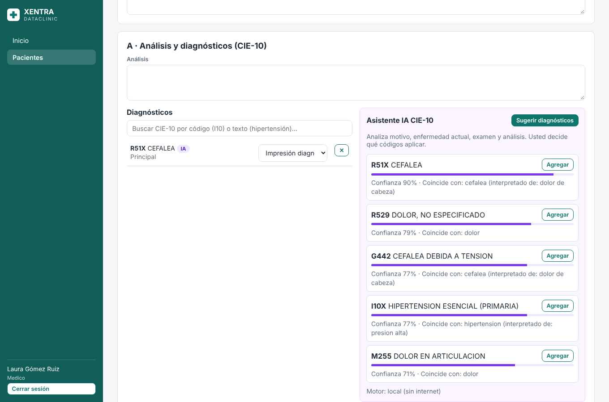
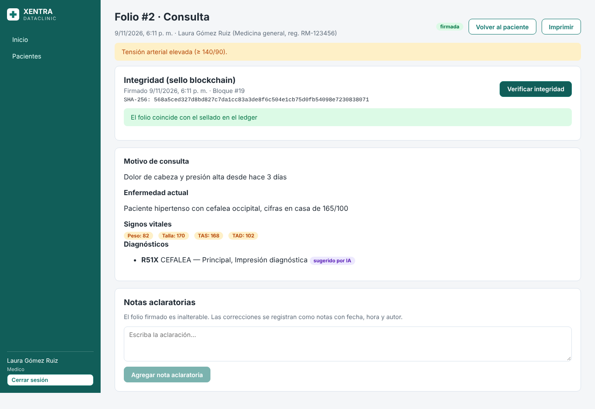
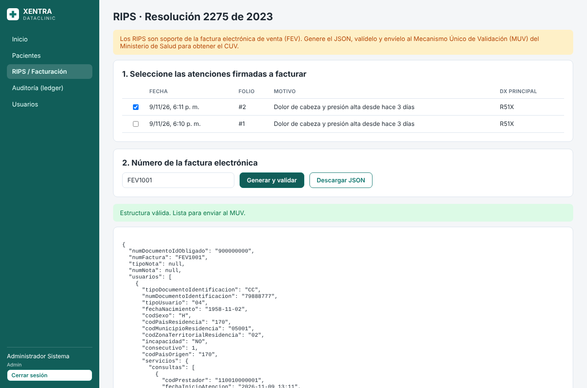
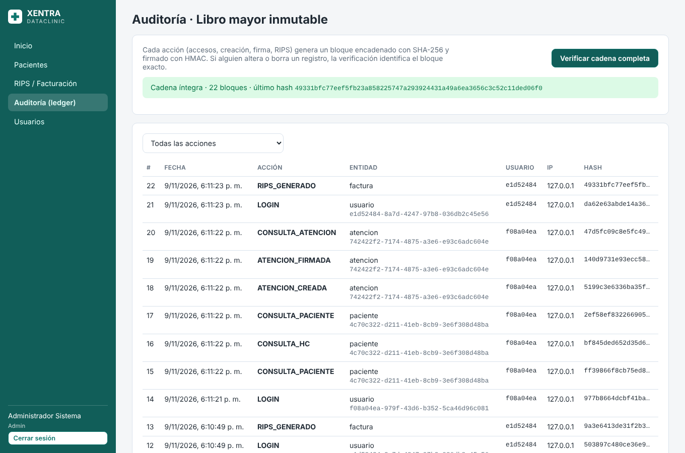

# XENTRA DATACLINIC

**Historia Clínica Electrónica (HCE) y gestión hospitalaria para Colombia**, con libro de auditoría
inmutable tipo *blockchain*, RIPS en JSON (Resolución 2275 de 2023), asistente de inteligencia
artificial para codificación CIE-10 y control de acceso por roles.

| Capa | Tecnología | Por qué |
|---|---|---|
| Backend (API) | **Python 3.13 + FastAPI** | Rápido, tipado, documentación automática de la API (Swagger). |
| Base de datos | **PostgreSQL 16** | Robusta, gratuita, con *triggers* para hacer la HC inalterable. |
| Frontend | **Vue 3 + TypeScript + Vite + Pinia** | Moderno, fácil de aprender, tipado para evitar errores. |
| IA | Motor local (sin internet) + **Claude** de Anthropic (opcional) | Funciona sin conexión; con Claude mejora la precisión. |
| Despliegue | **Docker Compose + Nginx** | Un solo comando levanta todo, igual en su PC y en el servidor. |

> **Sobre "PostgREST"**: usted mencionó *postgrest*. Ojo: **PostgreSQL** es la base de datos;
> **PostgREST** es otra herramienta que expone la BD directamente como API. Con FastAPI **no se
> necesita PostgREST** (y es mejor así: las reglas clínicas y de seguridad quedan en el backend).
> Ver la explicación completa en [docs/01-arquitectura.md](docs/01-arquitectura.md).

---

## ¿Qué hace hoy el sistema? (versión 0.1 – MVP funcional y probado)

- **Pacientes**: registro con los campos que exige RIPS (tipo/número de documento, DIVIPOLA, régimen,
  EAPB), alergias visibles en rojo y **autorización de tratamiento de datos (Ley 1581 de 2012)**.
- **Historia clínica en formato SOAP**: motivo, enfermedad actual, antecedentes, signos vitales (con IMC
  y alertas automáticas: crisis hipertensiva, desaturación, fiebre…), examen físico, análisis, plan,
  **fórmula médica** y procedimientos CUPS.
- **Firma del folio**: al firmar, el folio queda **sellado e inalterable** (Res. 1995 de 1999). Los
  errores se corrigen con **notas aclaratorias**, también inmutables.
- **Seguridad tipo blockchain**: cada acción (inicio de sesión, consulta de una HC, firma, RIPS…) crea
  un bloque encadenado con SHA-256 y firmado con HMAC. Un botón verifica toda la cadena y señala el
  bloque exacto si alguien manipuló la base de datos.
- **IA CIE-10**: sugiere diagnósticos a partir del texto clínico, entiende lenguaje coloquial
  ("gripa", "presión alta", "ardor al orinar"), filtra por sexo/edad y **nunca inventa códigos**
  (todo se valida contra el catálogo). El médico siempre decide.
- **RIPS JSON (Res. 2275 de 2023)**: genera y valida el JSON de consultas y procedimientos por factura,
  listo para el Mecanismo Único de Validación (MUV).
- **Roles**: administrador, médico, enfermería, admisiones, facturación y auditor.
- **Seguridad**: contraseñas Argon2id, JWT de 30 minutos, bloqueo tras 5 intentos fallidos,
  cabeceras de seguridad, base de datos no expuesta a internet.

### Capturas

| Asistente IA CIE-10 | Folio firmado y verificado |
|---|---|
|  |  |
| **RIPS JSON** | **Auditoría (ledger)** |
|  |  |

---

## Inicio rápido (si ya tiene Docker)

```bash
git clone https://github.com/ingjosecastro/xentra-dataclinic.git
cd xentra-dataclinic
cp .env.example .env          # luego edite .env y cambie las claves
docker compose up -d --build
```

Abra **http://localhost:8080** e ingrese con `admin@xentra.co` y la clave `ADMIN_PASSWORD` de su `.env`.

**¿Es principiante?** Siga la guía paso a paso, sin saltarse nada:
👉 **[docs/02-guia-instalacion-principiantes.md](docs/02-guia-instalacion-principiantes.md)**

Usuarios de demostración (solo si `CARGAR_DATOS_DEMO=true`), todos con la clave `Demo12345*`:

| Correo | Rol |
|---|---|
| medico@xentra.co | Médico |
| enfermeria@xentra.co | Enfermería |
| facturacion@xentra.co | Facturación |
| auditor@xentra.co | Auditor |

---

## Documentación

| # | Documento | Contenido |
|---|---|---|
| 1 | [Arquitectura y decisiones](docs/01-arquitectura.md) | Qué tecnologías se usan, por qué, y qué cambiaría un experto |
| 2 | [Guía de instalación para principiantes](docs/02-guia-instalacion-principiantes.md) | Desde instalar Docker hasta usar el sistema |
| 3 | [Normatividad colombiana](docs/03-normatividad-colombiana.md) | Qué norma cumple cada función y qué falta |
| 4 | [Seguridad y "blockchain"](docs/04-seguridad-blockchain.md) | Cómo funciona el ledger y por qué no una blockchain pública |
| 5 | [RIPS](docs/05-rips.md) | Cómo se generan y validan los RIPS JSON |
| 6 | [Inteligencia artificial y CIE-10](docs/06-ia-cie10.md) | Motor local, Claude, catálogo oficial |
| 7 | [Hoja de ruta](docs/07-hoja-de-ruta.md) | Lo que falta para ser el mejor del mercado, por fases |
| 8 | [Guía para desarrolladores](docs/08-guia-desarrollo.md) | Estructura del código, pruebas y cómo agregar módulos |

## Estructura del proyecto

```
xentra-dataclinic/
├── backend/                 API FastAPI
│   ├── app/
│   │   ├── main.py          Punto de entrada
│   │   ├── models.py        Tablas de la base de datos
│   │   ├── schemas.py       Validación de datos de entrada/salida
│   │   ├── core/            Configuración, BD, seguridad, triggers de inmutabilidad
│   │   ├── api/             Rutas: auth, pacientes, atenciones, cie10, rips, auditoria
│   │   ├── services/        Lógica: ledger, rips, cie10, ia, historia
│   │   └── data/            Catálogo CIE-10 de muestra
│   └── tests/               Pruebas automáticas (pytest)
├── frontend/                Aplicación Vue 3
│   └── src/ (views, components, stores, router, api)
├── docs/                    Documentación
├── docker-compose.yml       Orquestación de contenedores
└── .env.example             Plantilla de configuración
```

## Aviso importante

Este software es una base técnica sólida, **no un producto certificado**. Antes de usarlo con pacientes
reales: cargue el catálogo CIE-10 oficial completo, valide los RIPS en el ambiente de pruebas del MUV,
haga una auditoría de seguridad (pentest), registre las bases de datos ante la SIC (RNBD) si aplica,
y revise el cumplimiento con un asesor jurídico en salud. Ver [docs/07-hoja-de-ruta.md](docs/07-hoja-de-ruta.md).
