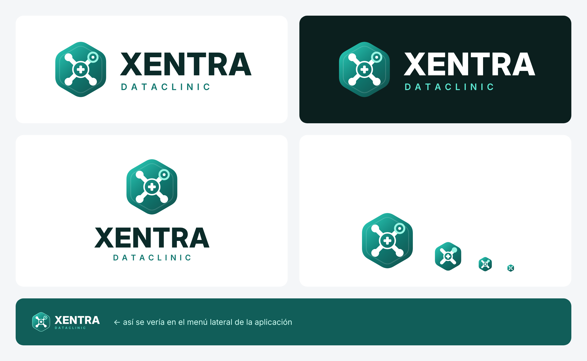

# Marca XENTRA DATACLINIC



## Concepto

| Elemento | Significado |
|---|---|
| **Hexágono** | Un *bloque* de la cadena (blockchain): la información está sellada y no se puede alterar |
| **X de cuatro brazos con nodos** | La inicial de XENTRA y, a la vez, una red de datos conectados (interoperabilidad: RIPS, FHIR, RDA) |
| **Nodo hueco arriba a la derecha** | El dato que sale de la institución hacia el ecosistema (IHCE, MUV, DIAN) |
| **Cruz médica en el centro** | El paciente y la atención en salud, en el núcleo de toda la tecnología |
| **Degradado verde azulado** | Salud, confianza y tecnología; armoniza con los colores de la aplicación |

## Archivos

| Archivo | Uso |
|---|---|
| `xentra-logo-horizontal.svg` | Uso principal sobre fondos claros (documentos, web, presentaciones) |
| `xentra-logo-horizontal-oscuro.svg` | Sobre fondos oscuros (ya trae el fondo) |
| `xentra-logo-menu.svg` | Sobre el verde del menú lateral de la aplicación (texto blanco, fondo transparente) |
| `xentra-logo-vertical.svg` | Formatos cuadrados: redes sociales, portadas, carnés |
| `xentra-simbolo.svg` | Solo el símbolo: avatar, sellos, marcas de agua |
| `favicon.svg` | Versión simplificada para tamaños de 16 a 64 px (pestaña del navegador, ícono de app) |

En `png/` están las mismas versiones en PNG de alta resolución con fondo transparente, para Word, PowerPoint y redes sociales.

Los textos están convertidos en trazos: se ven igual en cualquier computador, sin instalar fuentes.

## Colores

| Uso | Color |
|---|---|
| Degradado del símbolo | `#2dd4bf` → `#0f766e` → `#134e4a` |
| Acento (nodo de datos) | `#99f6e4` |
| Texto "XENTRA" sobre claro | `#0b2b29` |
| Texto "DATACLINIC" sobre claro / oscuro | `#0f766e` / `#5eead4` |

**Tipografía:** Inter Display ExtraBold (XENTRA) e Inter SemiBold (DATACLINIC), licencia SIL Open Font License (uso comercial libre).

## Reglas de uso

- Deje alrededor del logo un espacio libre mínimo igual a la mitad del alto del hexágono.
- Tamaño mínimo del logo horizontal: 120 px de ancho en pantalla o 3 cm impreso. Por debajo use solo el símbolo o el favicon.
- No lo deforme, no cambie los colores, no le agregue sombras ni lo ponga sobre fotos sin contraste.

## Antes de registrarlo

El diseño es original, creado desde cero para este proyecto. Aun así, antes de registrar la marca, haga una **búsqueda de antecedentes marcarios en la Superintendencia de Industria y Comercio (SIC)** para el nombre y el logo en las clases 9, 42 y 44 de Niza, y solicite el registro. Así queda protegido a su nombre en Colombia.

## Regenerar o modificar

```bash
pip install fonttools
python docs/marca/fuente/generar_logo.py docs/marca
```
